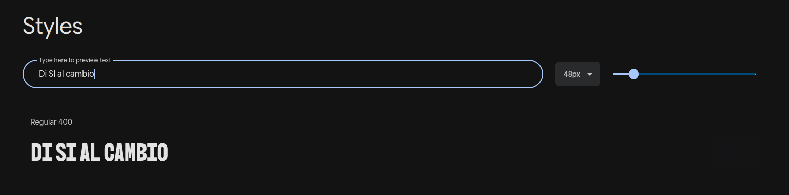
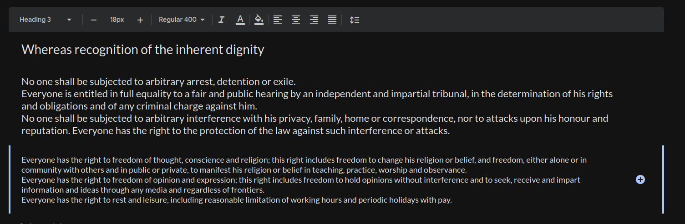
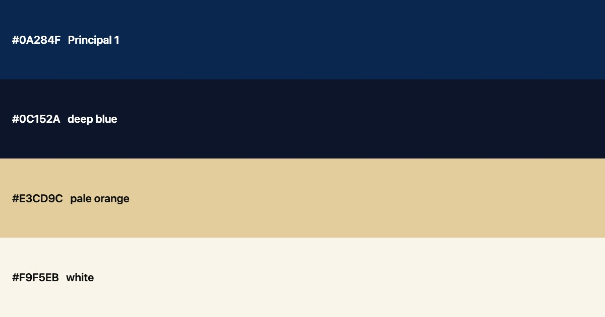
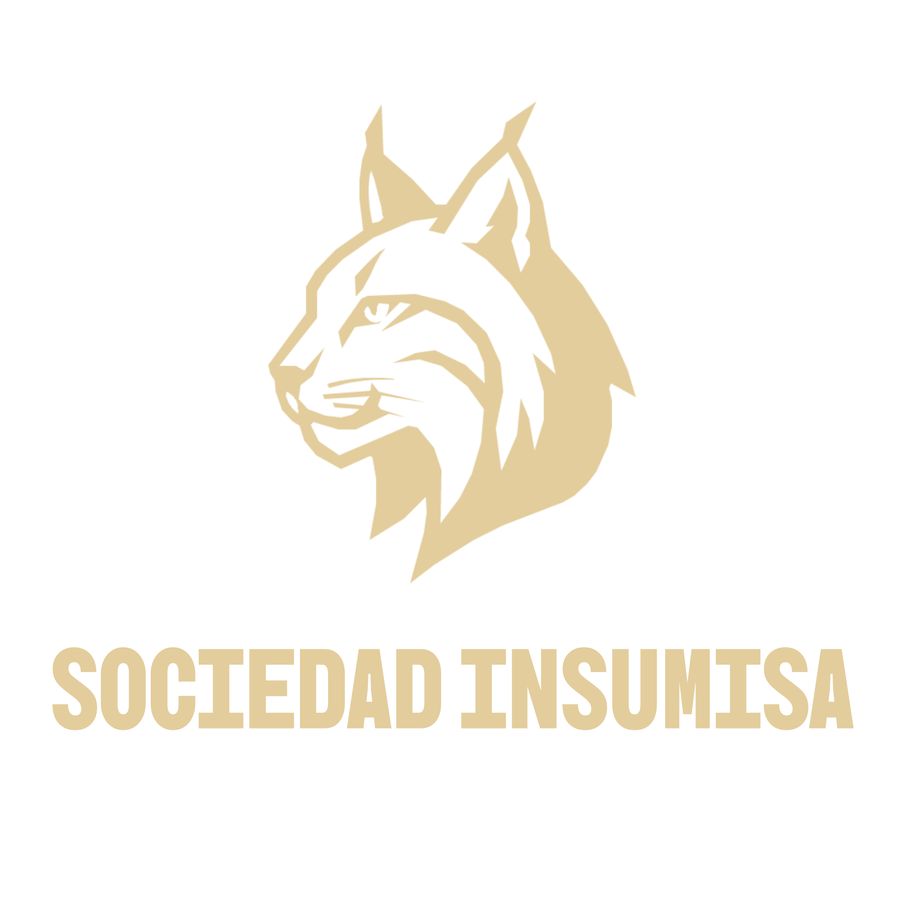
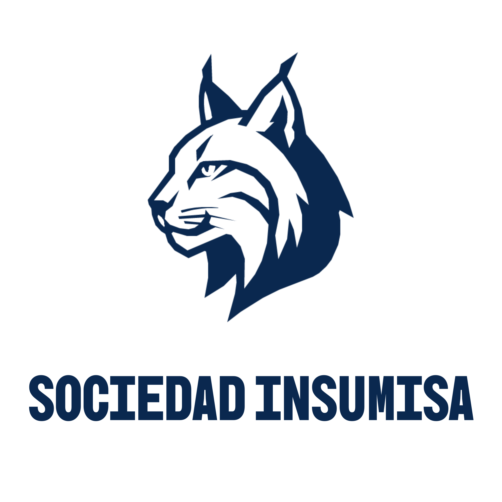
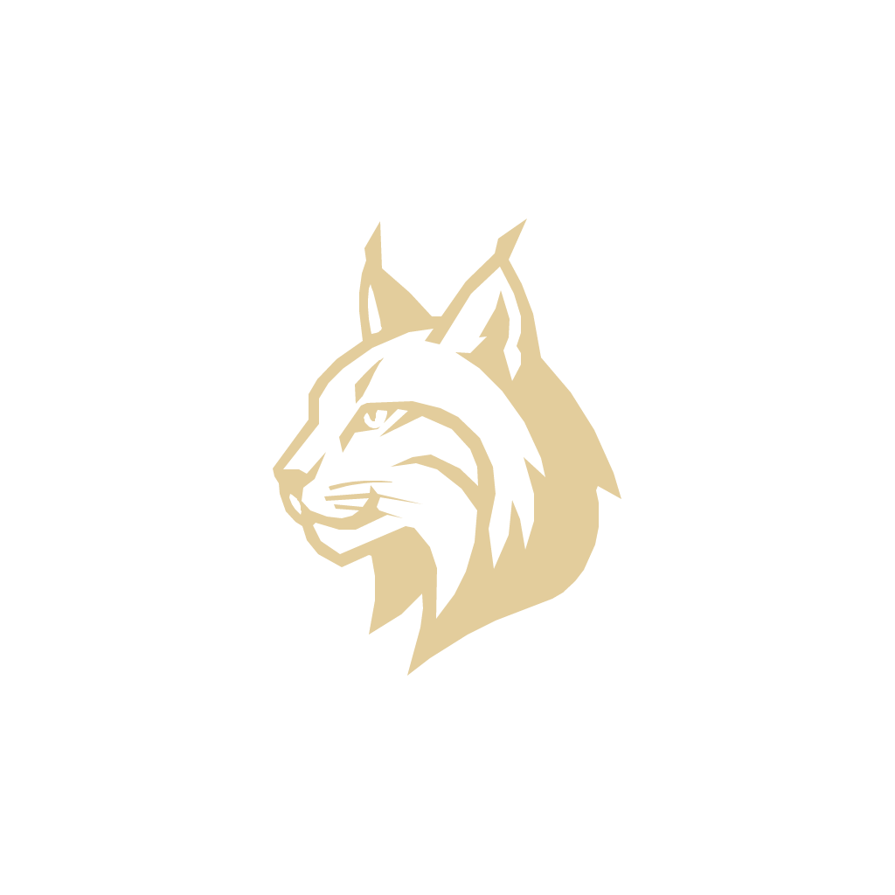
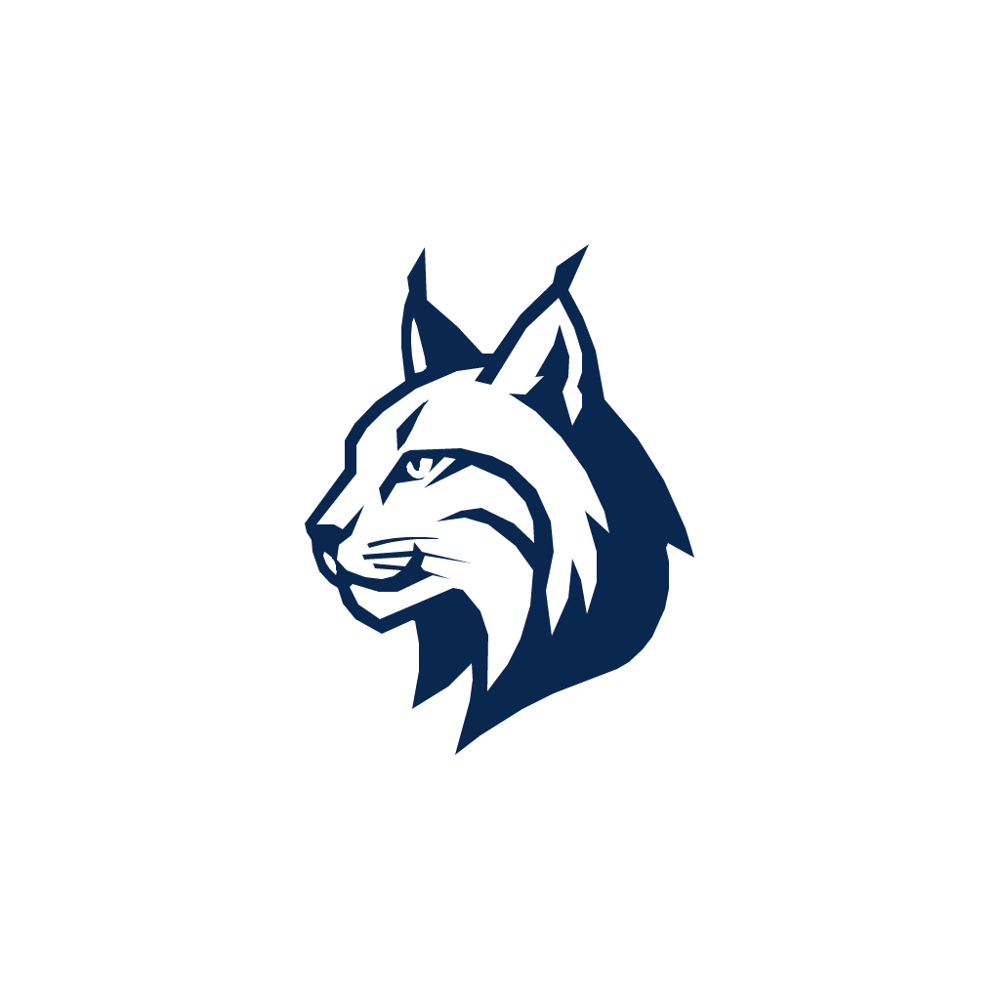
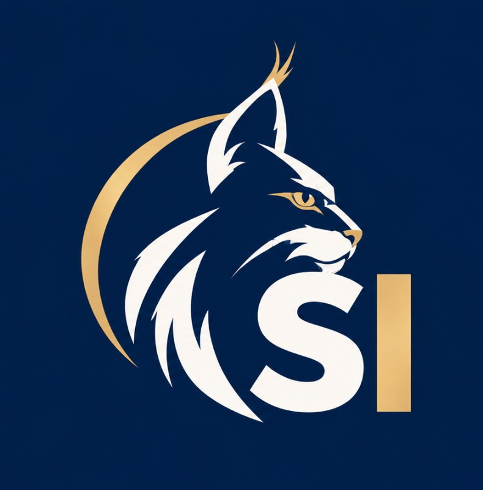

# Branding y prototipos - Decisiones

En esta página, presentamos las opciones que estuvimos mirando en cuanto a nombres y eslóganes, y defendemos las decisiones que tomamos al respecto.

---
## Nombres

* Contracorriente (diferencia a todo lo que ha habido hasta ahora) 

- Movimiento Liberal Ciudadano (clásico, muy largo) 

* **_[Sociedad Insumisa (juntamos el concepto de contracorriente)]{.underline}_**

Nos quedamos con éste último porque **junta las ideas** que teníamos el equipo sobre **qué debería representar el partido** y cómo. Además, tiene unas siglas pegadizas y llamativas (**SI**), que es algo que buscábamos.

---
## Eslóganes

* ¡Despierta! 

- Ahora, sí. Es el momento de cambiar. 

* **_Di SÍ al cambio (a la libertad, a cambiar las reglas, a decidir por ti, al poder de las personas, a una nueva etapa, a cuestionarlo todo, SÍ A PENSAR SIN PERMISO)_**

- Ni dioses ni reyes. Sólo nosotros. (No gods no kings, only man) (Sacado de BioShock, videojuego que muestra el objetivismo de Ayn Rand y "La rebelión de Atlas". Importante porque muestra la mentalidad política de nuestro partido)

* Insumisos por convicción, libres por decisión. 

* Ni rey ni roque (muy español) (le gusta a Max) 

- Porque quedarse quietos también es elegir .

Finalmente, nuestro lema será:

#### DÍ SÍ AL CAMBIO

Nos hemos decantado por este lema porque usa las siglas de nuestro partido (SI) de forma divertida y es **contundente y llamativo**, que es justo como quiere representarse nuestro partido.
Las otras consignas que hemos considerado serán utilizadas más tarde, en contenido promocional, pero no serán el lema principal del partido.

---
## Fuentes

Queremos que nuestras fuentes sean sencillas pero no demasiado simples, así que nos hemos decidido por las fuentes [BBH Bogle](https://fonts.google.com/specimen/BBH+Bogle?preview.script=Latn) y [Lato](https://fonts.google.com/specimen/Lato?preview.script=Latn), y las hemos encontrado en _Google Fonts_.

Usaremos BBH Bogle para la fuente del logo y otras frases principales, como el eslógan. Usaremos Lato para el resto de texto, ya que es más legible y sencilla.

### BBH Bogle:

### Lato:

---
## Colores

Buscábamos colores que representen **seriedad, formalidad y rectitud**, pero que, a la vez, llamen la atención. Nos decidimos por un **azul oscuro** (\#0A284F) y un **naranja pálido** (\#E3CD9C), tirando a dorado. Además, hemos elegido otros colores complementarios como **azul medianoche** (\#0C152A) y **blanco roto** (\#F9F5EB) para tener flexibilidad a la hora de crear contenido promocional. 
Que no sean siempre los mismos colores, pero parecidos.

Consideramos que estos colores son apropiados para mostrar nuestro objetivo de **prosperidad económica (oro) y solemnidad (azul oscuro)**.

La paleta la realizamos con [COLOURLovers](https://www.colourlovers.com/palettes/add).

---
## Logo

Para este apartado, nuestro profesor Josep Magraner nos dio unas cuantas ideas, y una que nos gustó mucho fue la imagen del Lince Ibérico ([_Lynx Pardinus_](https://es.wikipedia.org/wiki/Lynx_pardinus)) como representante. Así, de manera minimalista, quedó nuestro logo:

Otro logo que estuvimos debatiendo fue el siguiente, pero lo descartamos porque los anteriores eran más fáciles de manejar y más simples. Aún así, nos gustó, así que lo añadimos a la memoria:

